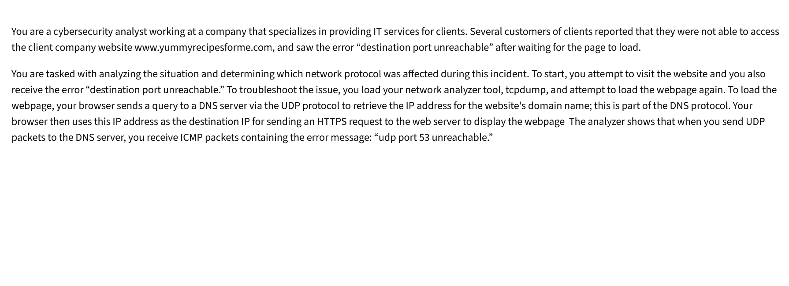

## Cybersecurity Incident Report: 
## Network Traffic Analysis

## A summary of the problem found in the DNS and ICMP traffic log.

 The browser (192.51.100.15) made a DNS query to the DNS server at 203.0.113.2, requesting the IP address of www.yummyrecipesforme.com. The query was made using the UDP protocol to port 53. Instead of the DNS server at 203.0.113.2 returning the IP address for www.yummyrecipesforme.com, an error message "udp port 53 unreachable" was sent back to 192.51.100.15 (Browser IP address).

This is based on the results of the network analysis, which show that the ICMP echo reply returned the error message: UDP port 53 unreachable.

 Domain name system Port 53. It listens to port 53 to resolve domain names to IP addresses.

 The DNS service could have crashed because there is no service listening to the port or a possible DOS attack. Leading to the response UDP port 53 unreachable.

## Time incident occurred: 1:24 PM, 32.192571 seconds.

 Several customers of clients reported that they were not able to access the client company website www.yummyrecipesforme.com and got the error message “ destination port unreachable”

 The IT department analyzed the situation to determine which network protocol was affected during the incident.

 The DNS service port to listen to the request was not reachable. Port 53 is a port for DNS service. The error message by ICMP “ unreachable” indicated the DNS service could not resolve the IP address of the www.yummyrecipesforme.com because the DNS service could not listen to the port. 
The DNS server could have crashed for not listening to the port, or likely a possible DOS attack, if the port is already flooded with traffic and overwhelmed the DNS server.

